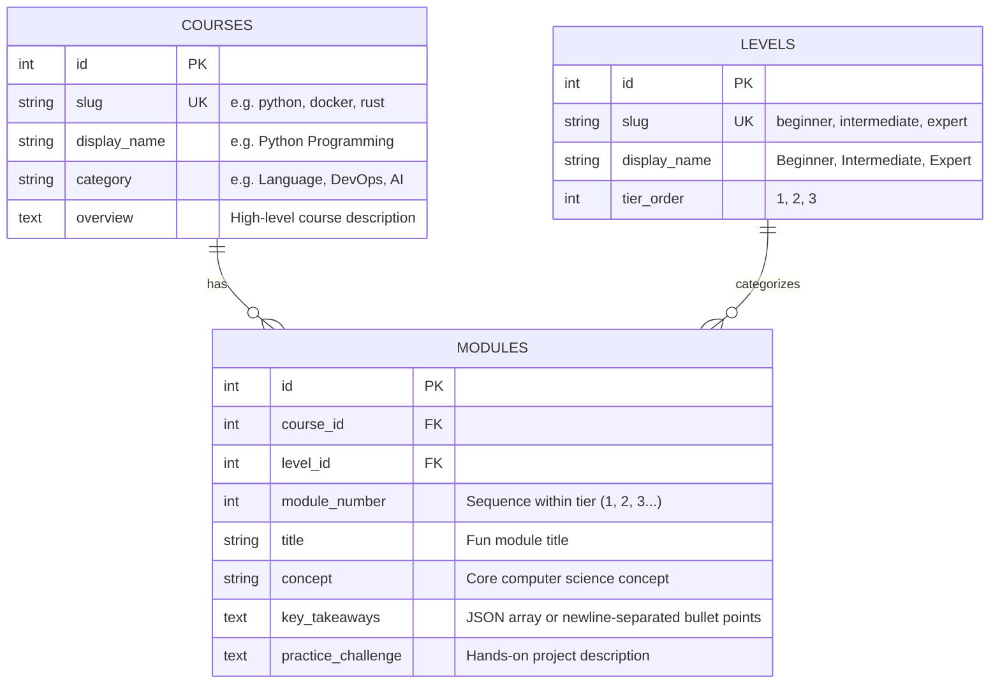

# Database Design Specification: Multi-Course & Multi-Tier Syllabus

**Project:** Agentic AI & MCP Python Mentor  
**Student:** Aditi  
**Instructor:** Dad  
**Document Purpose:** Defines the formal data architecture, schemas, and query interface to support multi-technology curriculums across multiple proficiency tiers.

---

## 1. Domain Requirements & Scope

The database must store and serve structured curriculum data catering to:

1. **7 Core Technologies:**
   - `python` (Python Programming)
   - `java` (Java Enterprise & Core)
   - `cpp` (C++ Systems & Modern C++)
   - `rust` (Rust Memory Safety & Concurrency)
   - `docker` (Containerization & Images)
   - `kubernetes` (Container Orchestration & Cluster Management)
   - `machine_learning` (Classical ML, Math & Deep Learning Foundations)

2. **3 Proficiency Tiers per Course:**
   - `beginner` (Fundamentals, syntax, mental models)
   - `intermediate` (Idiomatic design, modular architecture, core patterns)
   - `expert` (Internals, performance optimization, concurrency, system architecture)

3. **Query Access Patterns Supported:**
   - **General Course Overview:** `course="python", level="all"` (returns high-level roadmaps across all 3 tiers).
   - **Specific Tier Query:** `course="docker", level="beginner"` (returns modules, summaries, and objectives for that level).
   - **Topic/Module Deep Dive:** `course="kubernetes", level="expert", module_id=2` (returns in-depth concepts, quiz seeds, and hands-on exercises).
   - **Course Directory Listing:** `list_available_courses()` (returns supported technologies).

---

## 2. Architecture Comparison: Document (JSON) vs. Relational (SQLite)

| Feature | Option A: Document (`syllabus.json`) | Option B: Relational (`syllabus.db` - SQLite) |
| :--- | :--- | :--- |
| **Setup Overhead** | Zero dependencies, single text file. | Standard Python library (`sqlite3`), single file. |
| **Visual Accessibility** | 100% human-readable side-by-side in VS Code. | Requires SQLite viewer extension or CLI queries. |
| **Query Mechanism** | Dictionary traversal & list comprehensions. | Standard SQL queries (`SELECT ... WHERE ...`). |
| **Data Integrity** | Enforced by Python validation / schema. | Enforced by foreign keys, constraints, and types. |
| **Best Used For** | Fast 2–3 hour session walkthrough. | Enterprise migration demo & SQL learning. |

---

## 3. Option A: Document Model Schema (`syllabus.json`)

### 3.1 JSON Schema Specification
Each course is keyed by a unique normalized identifier (`slug`). Under each course, a `levels` dictionary splits the content into `beginner`, `intermediate`, and `expert`.

```json
{
  "$schema": "http://json-schema.org/draft-07/schema#",
  "title": "SyllabusDatabase",
  "type": "object",
  "additionalProperties": {
    "type": "object",
    "properties": {
      "course_name": { "type": "string" },
      "category": { "type": "string", "enum": ["Language", "DevOps", "AI/Data"] },
      "overview": { "type": "string" },
      "levels": {
        "type": "object",
        "properties": {
          "beginner": { "$ref": "#/definitions/LevelBlock" },
          "intermediate": { "$ref": "#/definitions/LevelBlock" },
          "expert": { "$ref": "#/definitions/LevelBlock" }
        },
        "required": ["beginner", "intermediate", "expert"]
      }
    },
    "required": ["course_name", "category", "overview", "levels"]
  },
  "definitions": {
    "LevelBlock": {
      "type": "object",
      "properties": {
        "tier_summary": { "type": "string" },
        "prerequisites": { "type": "array", "items": { "type": "string" } },
        "modules": {
          "type": "array",
          "items": {
            "type": "object",
            "properties": {
              "module_id": { "type": "integer" },
              "title": { "type": "string" },
              "concept": { "type": "string" },
              "key_takeaways": { "type": "array", "items": { "type": "string" } },
              "practice_challenge": { "type": "string" }
            },
            "required": ["module_id", "title", "concept", "key_takeaways"]
          }
        }
      },
      "required": ["tier_summary", "modules"]
    }
  }
}
```

### 3.2 Concrete JSON Data Example
```json
{
  "python": {
    "course_name": "Python Programming",
    "category": "Language",
    "overview": "From fundamental scripting to asynchronous engine design.",
    "levels": {
      "beginner": {
        "tier_summary": "Core syntax, variables, basic logic, and clean code fundamentals.",
        "prerequisites": ["None - curiosity to learn"],
        "modules": [
          {
            "module_id": 1,
            "title": "Magic Boxes",
            "concept": "Variables, Data Types & Formatting",
            "key_takeaways": [
              "Variables hold values like numbers, strings, and booleans",
              "Strings wear quotes; numbers do not",
              "f-strings allow clean string interpolation"
            ],
            "practice_challenge": "Create a personalized introduction card in terminal."
          },
          {
            "module_id": 2,
            "title": "Traffic Lights",
            "concept": "Control Flow & Conditionals",
            "key_takeaways": [
              "if/elif/else controls code execution paths",
              "Indentation defines code blocks",
              "Comparison operators: ==, !=, >, <"
            ],
            "practice_challenge": "Build an automated ticket pricing calculator based on age."
          }
        ]
      },
      "intermediate": {
        "tier_summary": "Object-Oriented Design, functional tools, file I/O, and modular packaging.",
        "prerequisites": ["Python Beginner"],
        "modules": [
          {
            "module_id": 1,
            "title": "Object Blueprints",
            "concept": "Classes, Objects & Dunder Methods",
            "key_takeaways": [
              "Classes are templates; objects are instances",
              "__init__ initializes state; __str__ provides string representation",
              "Encapsulation protects internal object state"
            ],
            "practice_challenge": "Design an RPG game character class with inventory management."
          }
        ]
      },
      "expert": {
        "tier_summary": "Asyncio concurrency, metaprogramming, memory optimization, and C-extensions.",
        "prerequisites": ["Python Intermediate"],
        "modules": [
          {
            "module_id": 1,
            "title": "Async Engines",
            "concept": "Event Loops, Coroutines & Concurrency",
            "key_takeaways": [
              "async/await syntax for non-blocking I/O",
              "Understanding asyncio event loops vs threading vs multiprocessing",
              "Task cancellation and exception shielding"
            ],
            "practice_challenge": "Build an asynchronous web scraper fetching 20 pages concurrently."
          }
        ]
      }
    }
  },
  "docker": {
    "course_name": "Docker Containerization",
    "category": "DevOps",
    "overview": "Package, ship, and run any application securely anywhere.",
    "levels": {
      "beginner": {
        "tier_summary": "Images, containers, basic Dockerfile authoring, and volume persistence.",
        "prerequisites": ["Basic terminal command navigation"],
        "modules": [
          {
            "module_id": 1,
            "title": "The Shipping Container",
            "concept": "Images vs Containers & Port Mapping",
            "key_takeaways": [
              "An image is a read-only recipe; a container is a live running instance",
              "docker run -p 8080:80 maps host ports to container ports",
              "Containers isolate filesystems and processes"
            ],
            "practice_challenge": "Run a local Nginx web server inside a Docker container."
          }
        ]
      },
      "intermediate": {
        "tier_summary": "Multi-stage builds, Docker Compose, network topologies, and layer caching.",
        "prerequisites": ["Docker Beginner"],
        "modules": [
          {
            "module_id": 1,
            "title": "Multi-Stage Dieting",
            "concept": "Optimizing image size with multi-stage Dockerfiles",
            "key_takeaways": [
              "Separate build dependencies from production runtime",
              "Drastically reduce final image size and attack surface"
            ],
            "practice_challenge": "Package a Go or Python application under 50MB using multi-stage build."
          }
        ]
      },
      "expert": {
        "tier_summary": "Container security hardening, rootless mode, storage drivers, and OCI specs.",
        "prerequisites": ["Docker Intermediate"],
        "modules": [
          {
            "module_id": 1,
            "title": "Fort Knox Containers",
            "concept": "Rootless containers, AppArmor, seccomp profiles",
            "key_takeaways": [
              "Never run container processes as root",
              "Drop unnecessary Linux capabilities (cap-drop=ALL)"
            ],
            "practice_challenge": "Audit and lock down a vulnerable container using seccomp and read-only rootfs."
          }
        ]
      }
    }
  }
}
```

---

## 4. Option B: Relational Model Schema (`syllabus.db` - SQLite)

### 4.1 Entity-Relationship Diagram (ERD)



### 4.2 SQLite DDL Script (`schema.sql`)

```sql
-- 1. Courses Table
CREATE TABLE IF NOT EXISTS courses (
    id INTEGER PRIMARY KEY AUTOINCREMENT,
    slug TEXT NOT NULL UNIQUE,
    display_name TEXT NOT NULL,
    category TEXT NOT NULL,
    overview TEXT NOT NULL
);

-- 2. Difficulty Tiers Table
CREATE TABLE IF NOT EXISTS levels (
    id INTEGER PRIMARY KEY AUTOINCREMENT,
    slug TEXT NOT NULL UNIQUE,
    display_name TEXT NOT NULL,
    tier_order INTEGER NOT NULL
);

-- 3. Modules Table
CREATE TABLE IF NOT EXISTS modules (
    id INTEGER PRIMARY KEY AUTOINCREMENT,
    course_id INTEGER NOT NULL,
    level_id INTEGER NOT NULL,
    module_number INTEGER NOT NULL,
    title TEXT NOT NULL,
    concept TEXT NOT NULL,
    key_takeaways TEXT NOT NULL, -- Stored as formatted JSON string
    practice_challenge TEXT,
    FOREIGN KEY (course_id) REFERENCES courses (id) ON DELETE CASCADE,
    FOREIGN KEY (level_id) REFERENCES levels (id) ON DELETE CASCADE,
    UNIQUE(course_id, level_id, module_number)
);

-- Indexes for lightning-fast queries
CREATE INDEX IF NOT EXISTS idx_modules_course_level ON modules(course_id, level_id);
CREATE INDEX IF NOT EXISTS idx_courses_slug ON courses(slug);
```

---

## 5. Unified MCP Tool Query Interface

Whether backed by JSON or SQLite, the MCP Server exposes a single, intuitive function interface to the AI Agent:

### 5.1 Tool Definition & Signature

```python
@mcp.tool()
def get_syllabus(course: str, level: str = "all") -> dict:
    """Fetches Dad's official syllabus for any technology track and proficiency level.

    Args:
        course: The technology to query. Supported: 'python', 'java', 'cpp', 'rust',
                'docker', 'kubernetes', 'machine_learning'.
        level: Proficiency level: 'beginner', 'intermediate', 'expert', or 'all'
               (defaults to 'all' if user asks generally).
    """
    course_clean = course.strip().lower()
    level_clean = level.strip().lower()
    
    # Executes query logic (JSON lookup or SQL SELECT)
    ...
```

### 5.2 Companion Exploration Tool
```python
@mcp.tool()
def list_available_courses() -> list[dict]:
    """Returns a directory of all available courses, categories, and supported levels."""
    ...
```

---

## 6. Natural Language Query Resolution Matrix

This matrix shows how the AI agent autonomously deconstructs informal student questions into exact tool parameters:

| Student Input Prompt | Inferred `course` | Inferred `level` | Generated Tool Call | What is Returned to Agent |
| :--- | :--- | :--- | :--- | :--- |
| *"What can I learn in Python?"* | `"python"` | `"all"` | `get_syllabus(course="python", level="all")` | High-level overview of beginner, intermediate, and expert modules. |
| *"Show me the beginner Python syllabus."* | `"python"` | `"beginner"` | `get_syllabus(course="python", level="beginner")` | Magic Boxes & Traffic Lights modules with concepts and takeaways. |
| *"What is covered in Kubernetes expert track?"* | `"kubernetes"` | `"expert"` | `get_syllabus(course="kubernetes", level="expert")` | Deep-dive topics (Custom Controllers, eBPF, Cluster federation). |
| *"I want to learn Docker intermediate."* | `"docker"` | `"intermediate"` | `get_syllabus(course="docker", level="intermediate")` | Multi-stage builds, Docker Compose, caching. |
| *"What courses do you teach?"* | None | None | `list_available_courses()` | List of all 7 courses with category tags. |
| *"Quiz me on Module 1 of Rust beginner!"* | `"rust"` | `"beginner"` | `get_syllabus(course="rust", level="beginner")` | Module 1 data (Ownership & Borrowing) $\rightarrow$ Agent generates 3 quiz questions. |

---

## 7. Pedagogical Value for Aditi

1. **Understanding Data Modeling:**
   - She sees how unstructured human concepts ("I want to learn Python") map into structured entities (`course`, `level`, `modules`).
2. **Separation of Concerns:**
   - The database stores pure, uncorrupted facts.
   - The MCP server acts as the secure query gateway.
   - The LLM acts as the creative mentor who reads the facts and teaches them in an engaging style.
3. **Multi-Parameter Extraction:**
   - Aditi observes how the AI automatically extracts multiple variables (`course` and `level`) from natural language without writing brittle parser rules.
