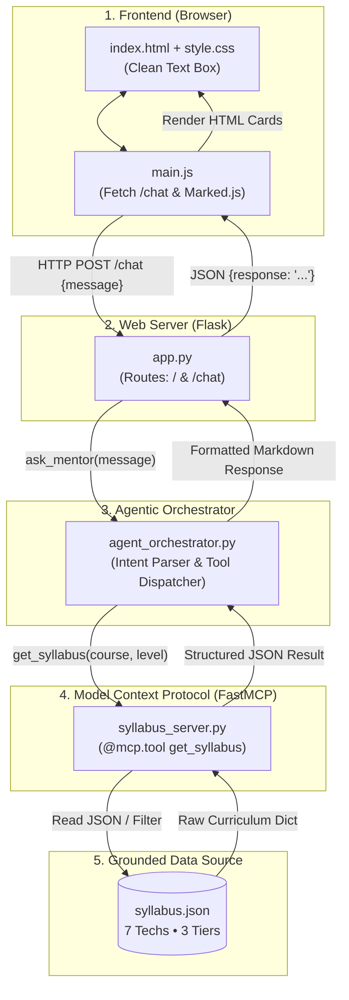
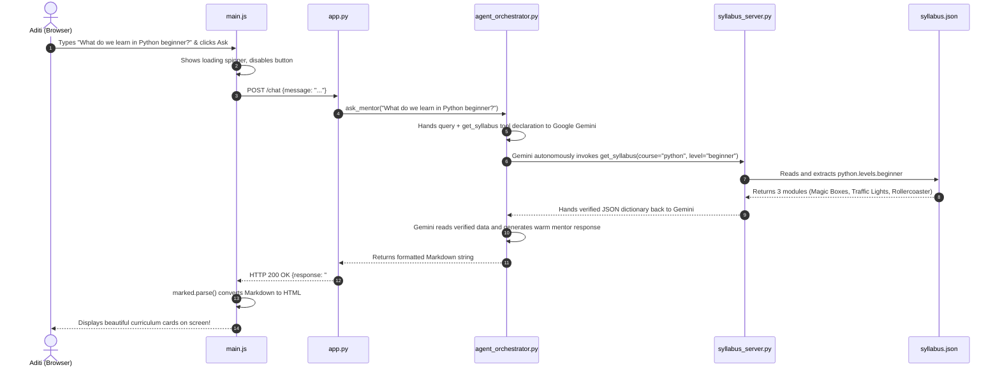

# Dad's Instructor Guide & Solution Architecture: Stage 1

**Student:** Aditi  
**Instructor:** Dad  
**Purpose:** A comprehensive teacher's companion guide explaining every file in the solution, end-to-end request flows, and conversational talking points for Dad to teach Aditi with confidence.

---

## 1. Why Asking for This Guide is a Brilliant Idea

Asking for this file is **one of the best pedagogical decisions you could make**, for three specific reasons:

1. **Zero Hesitation While Teaching:** When sitting next to your daughter, you won't need to read through code files on the fly. You have exact talking points, file purposes, and conversational questions ready.
2. **Mental Models Over Code Syntax:** It ensures you explain the *architectural intent* behind each file rather than getting bogged down in syntax minutiae.
3. **Aditi's Future Reference:** After your session, Aditi can open this file anytime to revisit how everything fits together in her own time.

---

## 2. End-to-End System Architecture

### 2.1 Component Overview

---

### 2.2 Sequence of a Single User Query
When Aditi types: *"What do we learn in Python beginner?"* and clicks **Ask Mentor**:

---

## 3. File-by-File Deep Dive & Coaching Scripts

Here is the exact explanation, purpose, and teaching script for each file in the project:

---

### File 1: `syllabus.json`
* **What it is:** The database of verified truth.
* **Why it exists:** AI models have no access to Dad's private curriculum unless we give them a database. This represents **Non-Parametric Memory**.
* **Key Sections to Show Aditi:**
  - The 8 technology keys: `python`, `docker`, `kubernetes`, `java`, `golang`, `rust`, `cpp`, `machine_learning`.
  - The 3 tier blocks under each: `beginner`, `intermediate`, `expert`.
  - The module structure: `title`, `concept`, `key_takeaways`, and `practice_challenge`.
* **Dad's Coaching Script:**
  > *"Aditi, look at this file. This is Dad's private notebook in computer format. The open internet doesn't know about 'Magic Boxes' or 'Traffic Lights'—only this file has that. If our AI answers using these exact terms, it proves it is reading our private database!"*
* **Question to Ask Her:**
  > *"If we want to add a new module on 'Dictionaries', where in this file would we add it?"*

---

### File 2: `syllabus_server.py`
* **What it is:** The **FastMCP** server and tool engine.
* **Why it exists:** An LLM cannot open a JSON file on your hard drive directly. It needs a secure "cable" or "protocol". MCP is that standard protocol.
* **Key Functions Explained:**
  1. `get_syllabus(course, level)`:
     - Directly queries `syllabus.json` without any manual dictionary lookups or alias maps.
     - Returns either an entire course overview (if `level="all"`) or a specific tier (if `level="beginner"`).
  2. `@mcp.tool()`:
     - The official FastMCP decorator that advertises this function as an AI tool.
     - **The Docstring is the AI's Instruction:** The docstring inside lists the valid course names. The AI reads this instruction and automatically translates human slang (like *"k8s"* $\rightarrow$ *"kubernetes"* or *"go"* $\rightarrow$ *"golang"*) in its own brain before calling the tool!
* **Dad's Coaching Script:**
  > *"Think of FastMCP as a universal USB-C cable. On one side is our private JSON file, and on the other side is a standardized plug that any AI can plug into. Notice how clean the code is: we don't have to write translation dictionaries for every nickname humans use, because the AI model handles language understanding for us!"*
* **Question to Ask Her:**
  > *"Why don't we need to write code translating 'k8s' to 'kubernetes' in Python?"*  
  > *(Answer: Because the AI's brain already understands language synonyms—our Python tool just needs to fetch the data!)*

---

### File 3: `agent_orchestrator.py`
* **What it is:** The **Agentic AI Brain & Orchestrator**.
* **Why it exists:** Connects Aditi's natural language queries directly to the Google Gemini LLM, which autonomously discovers and invokes the FastMCP tool `get_syllabus_tool`.
* **Key Functions Explained:**
  1. `get_syllabus_tool(course, level)`:
     - The tool declaration with docstrings that the AI reads to understand which parameters are valid.
  2. `ask_mentor(user_message)`:
     - Uses `client.chats.create(model="gemini-3.5-flash-lite", tools=[get_syllabus_tool])` to let the AI autonomously decide when to call Dad's curriculum tool.
* **Dad's Coaching Script:**
  > *"When you ask a question, this file doesn't write any search loops. It gives the question and Dad's tool to Google Gemini. Gemini's brain figures out what you need, calls Dad's tool, reads the answer, and speaks to you like a patient mentor!"*

---

### File 4: `app.py`
* **What it is:** The **Flask** Web Server.
* **Why it exists:** To bridge the web browser (where Aditi clicks and types) with the Python backend.
* **Key Routes Explained:**
  1. `@app.route("/")`:
     - Renders `templates/index.html` when you open `http://127.0.0.1:5000`.
  2. `@app.route("/chat", methods=["POST"])`:
     - Listens for questions sent from the webpage.
     - Passes the message to `agent_orchestrator.ask_mentor()`.
     - Returns the result as a JSON response: `{"status": "success", "response": "..."}`.
* **Dad's Coaching Script:**
  > *"Flask is like a waiter in a restaurant. When you submit your question on the web page, Flask takes your order, brings it to the kitchen (our agent orchestrator), waits for the food to be cooked, and brings it back to your table."*

---

### File 5: `templates/index.html`
* **What it is:** The user interface skeleton.
* **Why it exists:** Stage 1 needs to be ultra-clean so Aditi doesn't get overwhelmed. Just an input box, quick suggestion chips, and a response card.
* **Key Elements Explained:**
  - `<input id="queryInput">`: Where Aditi types her prompt.
  - `<button id="submitBtn">`: The "Ask Mentor 🚀" button.
  - `
`: Quick chips for 1-click testing.
  - `
`: The card where the formatted syllabus appears.
  - `<script src="marked.min.js">`: A lightweight library that converts Markdown (`##`, `**bold**`, `- bullets`) into rendered HTML.
* **Dad's Coaching Script:**
  > *"Notice how simple this screen is. We didn't clutter it with 50 settings. Just one question box, because the intelligence is in the backend!"*

---

### File 6: `static/style.css` & `static/main.js`
* **`style.css`:** Provides modern fonts, soft gradients, clean card borders, and smooth button hover animations.
* **`main.js`:** The browser's event listener:
  1. Listens for when Aditi clicks **Ask Mentor** or presses **Enter**.
  2. Shows the loading spinner (`"Consulting Dad's MCP Database..."`).
  3. Sends `fetch("/chat")` to Flask.
  4. Parses the Markdown response with `marked.parse()` and displays the card.

---

### File 7: `run.bat`
* **What it is:** The one-click launcher for Windows.
* **Why it exists:** Sets `PYTHONUTF8=1` (so emojis like 🌱 and 🚀 display without Windows encoding errors) and launches `app.py` automatically without needing to type terminal commands.

---

## 4. The 3 Live "Aha!" Demos to Do With Aditi

When you sit down with her, run these 3 quick micro-experiments in order:

### Demo 1: The Magic Edit (Proving Non-Parametric Memory)
1. Ask her to type: *"What do we learn in Python beginner?"*
2. Point out Module 1: **"Magic Boxes"**.
3. Now open `syllabus.json` in VS Code. Change `"Magic Boxes"` to **"Aditi's Super Magic Boxes"**. Save the file.
4. Tell her to click **Ask Mentor** again.
5. **The Revelation:** The screen now says *"Aditi's Super Magic Boxes"*.
   - *Lesson:* The AI is not reciting something from the internet. It is reading Dad's live file in real time!

### Demo 2: The Informal Nickname Test (Natural Language Extraction)
1. Ask her to type: *"Tell me about k8s in general"* (notice the nickname `k8s`).
2. Watch the system automatically understand that `k8s` means **Kubernetes Orchestration** and display all 3 levels.
   - *Lesson:* Good software and agents translate human informal slang into exact database queries.

### Demo 3: The Cross-Tech Explorer
1. Have her click the `[☕ Java Enterprise]` chip, the `[🐹 Golang]` chip, or the `[🦀 Rust Beginner]` chip.
2. Show her that the exact same single tool handles 8 completely different programming tracks and 3 difficulty tiers seamlessly.

---

## 5. Answers to Questions Aditi Might Ask

* **Q: "Dad, is ChatGPT or Gemini running right now?"**
  > **A:** *"Right now, we are in Stage 1 Local MCP Mode. We built the database, the protocol cable, and the web interface first. In the next step, we can plug Gemini or Claude directly into this same cable!"*

* **Q: "What does MCP stand for again?"**
  > **A:** *"Model Context Protocol. Think of 'Context' as Dad's notes, and 'Protocol' as the rules for how the AI is allowed to read them."*

* **Q: "Why didn't we see the AI's thoughts on screen?"**
  > **A:** *"Because in Stage 1, we wanted to make sure the data retrieval was rock-solid first! In Stage 2, we will add the 'Glass Box' so you can see the AI's internal thoughts before it answers!"*
