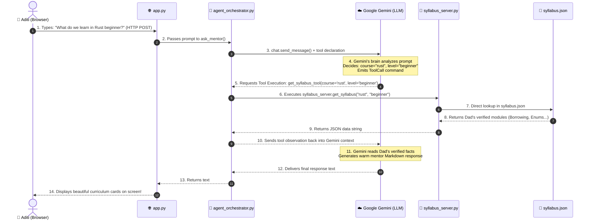

# The Complete Agentic AI Execution Flow

**Student:** Aditi  
**Instructor:** Dad  
**Core Purpose:** A visual, step-by-step master reference explaining how Aditi's question travels from the browser, through Google Gemini's neural network, into Dad's private MCP database, and back to her screen.

---

## 1. High-Level Visual Architecture

```
                       THE COMPLETE AGENTIC FLOW
                       
  [1. Aditi's Browser]
         │  Types: "What do we learn in Rust beginner?"
         ▼  HTTP POST /chat {"message": "..."}
  [2. Flask Web Server: app.py] (Line 29)
         │  Calls ask_mentor(message)
         ▼
  [3. Agent Orchestrator: agent_orchestrator.py] (Line 41)
         │  Sends prompt + tool declaration via Google GenAI SDK
         ▼
  ┌─────────────────────────────────────────────────────────────┐
  │         4. GOOGLE GEMINI NEURAL NETWORK (In Cloud)          │
  │                                                             │
  │  • Reads: "What do we learn in Rust beginner?"              │
  │  • Reads Tool Docstring: get_syllabus_tool(course, level)   │
  │  • DECIDES: course = "rust", level = "beginner"             │
  │  • EMITS: ToolCall -> get_syllabus_tool("rust", "beginner") │
  └──────────────────────────────┬──────────────────────────────┘
                                 │
                                 │ Gemini calls back our local Python function
                                 ▼
  [5. Local Tool Wrapper: agent_orchestrator.py] (Line 28)
                                 │
                                 │ Calls syllabus_server.get_syllabus("rust", "beginner")
                                 ▼
  [6. FastMCP Server: syllabus_server.py] (Line 25)
                                 │
                                 │ Direct dictionary lookup (Zero manual maps!)
                                 ▼
  [7. Dad's Private Database: syllabus.json]
                                 │
                                 │ Returns verified JSON data:
                                 │ - Module 1: The Borrowing Rulebook
                                 │ - Module 2: The Swiss Army Knife
                                 ▼
  ┌─────────────────────────────────────────────────────────────┐
  │         8. GOOGLE GEMINI NEURAL NETWORK (In Cloud)          │
  │                                                             │
  │  • Receives verified JSON data                              │
  │  • Synthesizes a warm, encouraging mentor explanation       │
  └──────────────────────────────┬──────────────────────────────┘
                                 │
                                 ▼  Returns final Markdown response
  [9. Flask Server -> Browser]
  Rendered as beautiful cards on Aditi's screen!
```

---

## 2. Sequence Diagram (Step-by-Step Round Trip)



---

## 3. Deep Dive into the 5 Core Questions

### Q1: Who is calling `def get_syllabus(...)`?
* **Google Gemini is calling it.**
* In [agent_orchestrator.py](file:///D:/manoj_backup/Ananta%20Infotech/Training/AgenticAIAditiFinal/agent_orchestrator.py), we hand the tool to the Gemini chat session. When Gemini decides it needs Dad's official curriculum, the Google GenAI SDK executes `get_syllabus_tool` on our machine, which calls `syllabus_server.get_syllabus(...)`.

---

### Q2: How is it calling it?
* Through **Automatic Function Calling (Tool Calling)**.
* Instead of generating conversational words immediately, the LLM emits a structured JSON payload:
  ```json
  {
    "name": "get_syllabus_tool",
    "args": {
      "course": "rust",
      "level": "beginner"
    }
  }
  ```
* The SDK catches this payload, runs the Python function with those exact arguments, and feeds the output back to the model.

---

### Q3: How and WHERE are `course` and `level` being decided?
* **Inside Google Gemini's neural network in the cloud — NOT in Python!**
* There is **zero regex and zero `if/else` keyword parsing** in our Python code.
* In [agent_orchestrator.py](file:///D:/manoj_backup/Ananta%20Infotech/Training/AgenticAIAditiFinal/agent_orchestrator.py), we wrote this docstring:
  ```python
  """Fetches Dad's official syllabus for any technology track and proficiency level.

  Args:
      course: The exact technology name ('python', 'java', 'golang', 'rust', 'cpp', 'docker', 'kubernetes', 'machine_learning').
      level: Proficiency level ('beginner', 'intermediate', 'expert', or 'all').
  """
  ```
* Gemini reads this docstring. When Aditi asks: *"Tell me about k8s"* or *"What is in Rust beginner?"*, Gemini uses its natural language understanding to map *"k8s"* $\rightarrow$ `'kubernetes'` and *"Rust beginner"* $\rightarrow$ `course='rust', level='beginner'`.

---

### Q4: WHERE is the LLM call happening?
* In **[agent_orchestrator.py](file:///D:/manoj_backup/Ananta%20Infotech/Training/AgenticAIAditiFinal/agent_orchestrator.py) at line 70**:
  ```python
  # Line 70 in agent_orchestrator.py:
  response = chat.send_message(clean_msg)
  return response.text
  ```
* This line sends an encrypted HTTPS call to Google's Gemini server (`gemini-3.5-flash-lite`), handles the tool call execution loop, and returns Gemini's final written answer.

---

### Q5: HOW is MCP coming into play?
* **Model Context Protocol (MCP)** is the open standard that connects AI models to external data.
* In **[syllabus_server.py](file:///D:/manoj_backup/Ananta%20Infotech/Training/AgenticAIAditiFinal/syllabus_server.py)**:
  - We use FastMCP (`@mcp.tool()`) to expose Dad's private `syllabus.json` as a standardized tool.
  - Gemini knows nothing about Dad's private files. MCP acts as the **"universal USB cable"** allowing Gemini to read private local records without hallucinating.

---

## 4. The Architectural Contrast

| Traditional Coding (Old Way) | Pure Agentic AI (Our System) |
| :--- | :--- |
| Huge dictionaries (`alias_map = {"k8s": "kubernetes", "py": "python"...}`) | **Zero dictionaries.** The LLM understands language synonyms natively. |
| Brittle regex pattern matching (`re.search(r"\bpython\b")`) | **Zero regexes.** The LLM extracts parameters using semantic comprehension. |
| Hardcoded Markdown string formatting loops | **Generative Synthesis.** The LLM formats clean Markdown with warm, encouraging mentor tone. |
| Breaks on typos or new phrases | Adapts smoothly to informal phrasing, slang, and full sentences. |

---

## 5. Dad's Coaching Script for Aditi

> *"Aditi, look at this diagram. Notice that Python didn't search for the word 'Rust' or 'Beginner' with search rules.*
> 
> *Instead, our program handed your sentence to Google Gemini. Gemini read Dad's tool label, figured out what you wanted, dialed our Python tool like a telephone, read Dad's private notes, and then wrote a personalized message just for you.*
> 
> *That is what makes it an **Agent**: an AI with the intelligence to decide **when** to use a tool and **how** to use the facts it discovers!"*
